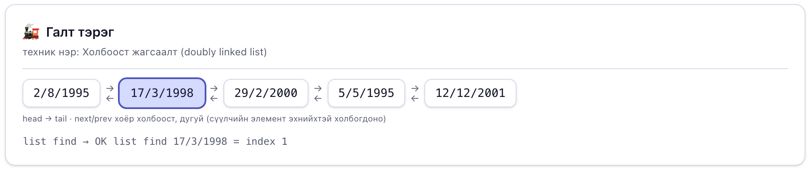
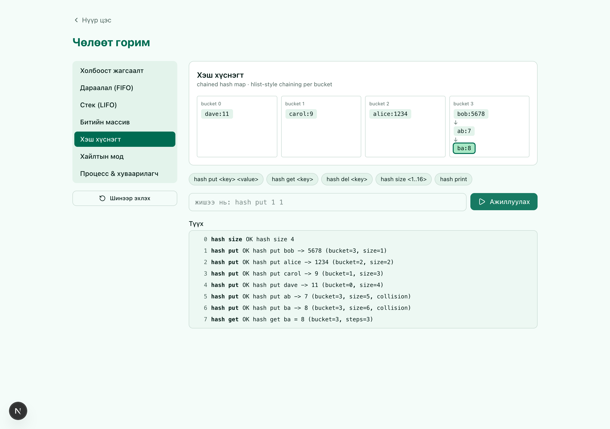
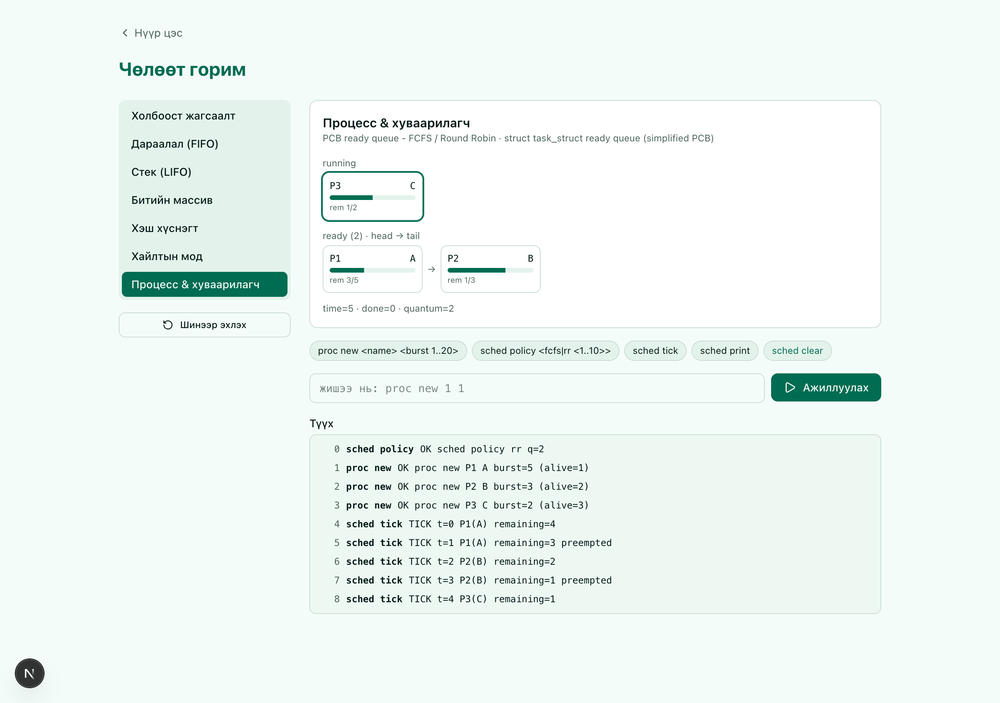

# Kernel Data Structures

**F.CSM302 Үйлдлийн систем · БД2 (Final, v1.1.0) · Хуваарилалтын код: V-1-4**
Үзүүлэлт: **Kernel structure graph** · Бүлэг: **3 – Processes** · Сурах бичиг: Silberschatz, Galvin, Gagne, *Operating System Concepts* (Programming Project «Kernel Data Structures», онол нь **Chapter 1 Introduction, 1.9 Kernel Data Structures, p. 36**)

## Үр дүн ба материал
| Материал | Холбоос |
|---|---|
| GitHub final release | [v1.1.0](https://github.com/grl059/OS_BD1/releases/tag/v1.1.0) |
| Final Report | [`docs/V-1-4_Final_Report.pdf`](docs/V-1-4_Final_Report.pdf) |
| Manual | [`docs/V-1-4_Manual.pdf`](docs/V-1-4_Manual.pdf) |

Веб апп (бодит дэлгэцийн зураг). Зүүн талд холбоост жагсаалт, баруун талд хэш хүснэгтийн *collision* гинж, доор *Round Robin* scheduler:





## Зорилго
Linux kernel-ийн өгөгдлийн бүтцүүдийг хэрэгжүүлж, элемент **нэмэх, устгах, хайх** үйлдлийн дараах бүтцийг графаар харуулна:

| Бүтэц | Хэрэгжилт | Нэмэх / устгах / хайх |
|---|---|---|
| Холбоост жагсаалт | `list_head` (struct birthday), давхар холбоост дугуй | `add_head`, `add_tail` / `del` / `find` |
| Queue (FIFO), Stack (LIFO) | `list_head` дээр | `push` / `pop` / `find` |
| Bitmap | 1..128 бит | `set` / `clear` / `test` |
| Hash map | хэш = тэмдэгтийн кодын нийлбэр mod n, collision-д bucket доторх `hlist_head` жагсаалт (Linux `hashtable.h`-ийн бүтэц); ачаалал 0.75-аас хэтэрвэл bucket ×2 (`hash auto on`), гараар `rehash`, `hash stats` | `put` / `del` / `get` / `rehash` / `stats` |
| Binary search tree | энгийн BST ба тэнцвэржсэн AVL (`tree mode avl`); `tree stats` – өндөр, эргүүлэлтийн тоо | `insert` / `delete` / `find` / `stats` |
| Red-black tree | Linux CFS scheduler-ийн мод; өнгө, black-height, эргүүлэлтийн тоо (AVL-тэй харьцуулах) | `insert` / `delete` / `find` / `print` |
| Min-heap (priority queue) | массив дээрх хоёртын овоолго, хамгийн ихдээ 16; sift-ийн swap тоог харуулна | `push` / `pop` / `peek` / `print` |
| Процесс ба scheduler | PCB + `list_head` ready queue, FCFS ба Round Robin | `proc new` / дуусах / `sched print` |
| Kernel module | `struct color` жагсаалт, `start` параметртэй Collatz жагсаалт, birthday, kfifo, bitmap, Linux-ийн `<linux/hashtable.h>`, `<linux/rbtree.h>` систем толгой файлууд, `/proc/kds` | `insmod` / `rmmod` / `cat /proc/kds` |

## Quick Start (Linux / macOS / WSL; gcc, make)
```sh
git clone https://github.com/grl059/OS_BD1.git kernel-data-structures
cd kernel-data-structures
make                        # src/user/kds.c -> ./kds (ASan + UBSan)
make test                   # 9 PASS (жишээ скриптүүд + stress)
./kds examples/textbook.txt
```
**macOS 26 + Apple clang:** the bundled ASan runtime can hang while initializing
(no output, 100% CPU). Build without sanitizers instead: `make SAN=0`; the tests
and the web app work the same, only the sanitizer checks are skipped.
**Веб интерфэйс** (Next.js; `../kds`-г шууд ажиллуулдаг, өөрөө дахин хэрэгжүүлдэггүй - `web/EVENT_FORMAT.md`):
```sh
make                        # эхлээд C цөмийг ./kds болгож build хийнэ
cd web
npm install                 # (эхний удаа)
npm run dev                 # http://localhost:3000
```
Цэс → Хичээл / Чөлөөт горим / Тухай. `/play` хуудас нь өөрийн бичсэн командыг `/api/run`-р дамжуулж, `kds --json`-ийн буцаасан JSON урсгалаас дэлгэцийг шууд дүүргэнэ - дэлгэц дээр харагдах бүх зүйл (жагсаалт, мод, scheduler progress bar гэх мэт) C программын state-ээс гаралтай.

Хичээлийн Багшийн тайлбар бүр монгол дуутай (`public/tts/*.mp3`, `mn-MN-YesuiNeural`). `say` текстээ засварлавал дахин үүсгэнэ:
```sh
python3 -m pip install --user edge-tts   # (эхний удаа)
cd web && node scripts/gen-tts.mjs
```

**Нэмэлт тест** (node ≥ 18, python3 хэрэгтэй):
```sh
make check                  # make test + --json==текст (json_check.py) + fuzz (8 seed x 5000 команд) + AVL, red-black/heap шалгалт: нийт 98 PASS
cd web && npm test           # lib/model.ts, lib/levels.ts - сүүлийнх нь ./kds-г жинхэнээр ажиллуулж шалгадаг
```

**Kernel module** (жинхэнэ Linux + `linux-headers-$(uname -r)`):
```sh
sh src/kernel/run_module_test.sh     # build, insmod (start=25, start=15, start=0), cat /proc/kds, rmmod
                                     # -> docs/kernel_build_log.txt, docs/kernel_dmesg.txt
```

## Туршсан орчин ба хамаарал
Ubuntu 24.04 (gcc 13, GNU make, Python 3.13, Node.js 22). `make check`-ийн 98 шалгалт, веб аппын 17 тест (`cd web && npm test`) энэ орчинд PASS. Windows дээр туршаагүй, macOS дээр зөвхөн CI.

## Командууд
```
list   add_head|add_tail|del|find <өдөр> <сар> <жил>  ·  list print|clear
queue  push|find <int>  ·  queue pop|print            (stack мөн адил, багтаамж 8)
bitmap size <1..128>  ·  bitmap set|clear|test <i>  ·  bitmap print
hash   size <1..16>  ·  hash put <key> <value>  ·  hash get|del <key>  ·  hash print|stats|clear
hash   auto on|off  (ачаалал > 0.75 бол bucket ×2, дээд тал нь 64)  ·  hash rehash <1..64>
tree   mode bst|avl  ·  tree insert|delete|find <int>  ·  tree print|stats
rb     insert|delete|find <int>  ·  rb print|clear        (red-black tree)
heap   push <int>  ·  heap pop|peek|print|clear         (min-heap, багтаамж 16)
proc   new <нэр> <ажил 1..20>
sched  policy fcfs|rr <квант 1..10>  ·  sched tick|print|stats|clear   (stats = дундаж хүлээлт, turnaround)
```
`#`-ээс хойших хэсэг коммент. Буруу оролт бүр `ERR ...` мессеж өгнө.

## Repository бүтэц
| Зам | Агуулга |
|---|---|
| `src/user/kds.c` | User-space хэрэгжилт (list.h-ийн `list_head`, `container_of`) + командын интерпретатор + `--json` горим (вэб-д зориулсан, текст горимыг өөрчлөхгүй) |
| `src/kernel/` | Linux kernel module, Makefile, `run_module_test.sh` |
| `web/` | Next.js веб апп - `src/app` (хуудсууд, `/api/run`), `src/components`, `src/lib` (`model.ts`, `config.ts`, `levels.ts`, `use-run.ts`), `public/tts/` (Багшийн монгол дуут тайлбар), `scripts/gen-tts.mjs` (дууг дахин үүсгэх), `EVENT_FORMAT.md` - JSON протоколын тодорхойлолт |
| `examples/` | textbook, all_structures, errors, search, scheduler, scheduler_full, hash_resize, rb_heap |
| `tests/` | хүлээгдэх гаралт, `run_tests.sh`, `json_check.py`, `fuzz_json.py`, `avl_check.py`, `rb_check.py` (red-black ба heap-ийн инвариант) |
| `.github/workflows/` | `ci.yml` (C цөм + веб апп build/тест, ubuntu+macos), `release.yml` (CI амжилттай болсон тутамд conventional-commit дүрмээр хувилбар нэмэгдүүлж release гаргадаг) |
| `docs/` | `V-1-4_Final_Report.pdf`, `V-1-4_Manual.pdf`, `KERNEL_EVIDENCE.md` (kernel module-ийн нотолгооны тайлбар); `report_src/img/` – веб UI ба kernel module-ийн бодит дэлгэцийн зураг |
| `docs/latex/` | Тайлан, Manual-ийн **албан ёсны эх** (report.tex, manual.tex, kds-preamble.tex; XeLaTeX + DejaVu фонт). Build: `sh docs/latex/build_latex.sh` – эцсийн PDF-үүдийг `docs/`-д хуулна. `docs/report_src/` нь HTML нөөц эх (`build_pdf.py`, playwright) |

## Known issues
- Kernel module-ийг жинхэнэ Linux дээр build хийнэ (WSL, Docker дээр ачаалагдахгүй). Secure Boot идэвхтэй бол MOK түлхүүрээр гарын үсэг зурна (Manual 2.7).
- Hash map-ийн автомат resize нь анхдагчаар **унтраастай** (`hash auto on`-оор асаана; хуучин жишээнүүдийн гаралт өөрчлөгдөхгүйн тулд). Дээд тал нь 64 bucket; queue, stack, процесс хамгийн ихдээ 8; hash 24 элемент.
- Вэб UI одоо C цөмийн 9 бүтэц бүрийг (rb улаан-хар мод, heap овоо орно) зурна; `/learn`-д 9 шат бий.
- Kernel module-ийн одоогийн хувилбар жинхэнэ Linux дээр (Ubuntu 24.04.2, kernel 6.11.0-17-generic, Secure Boot, MOK гарын үсэгтэй) ачаалагдаж `run_module_test.sh` 9 PASS өгсөн; Нотолгоо: Final Report-ын Зураг 6.2--6.4 ба `docs/KERNEL_EVIDENCE.md`. Түүхий log нь `docs/kernel_build_log.txt`, `docs/kernel_dmesg.txt`-д. Өөр kernel хувилбарт дахин build хийнэ.
- Нэг мөрөнд хамгийн ихдээ 16 үг (команд, үйлдэл + 14 утга); int-ийн муж `-2147483647..2147483647`; `bitmap size` нь бүх битийг цэвэрлэнэ.
- Scheduler-т бүх процесс `proc new` хийсэн мөчид ирнэ; I/O ба priority байхгүй.
- Веб апп нь C-г **дахин хэрэгжүүлдэггүй**: дэлгэц дээрх бүх зүйл `kds --json`-ийн гаргасан `state`-ээс шууд ирдэг (`tests/json_check.py`, `web` дотор `node --test` баталгаажуулна).

## Бэлэн код, сан, AI ашиглалт
- Гадны сан ашиглаагүй. `list_head`-ийн функцуудыг Linux `include/linux/list.h`-ийн семантикаар өөрсдөө бичсэн.
- **AI хэрэгсэл: Claude (Anthropic)** — тайлангийн ноорог, C програмыг UI-ийн хөдөлгүүртэй нийцүүлэх, тест скрипт, README/Manual засварт ашигласан. Бүх кодыг баг ажиллуулж, тестээр шалгасан.
